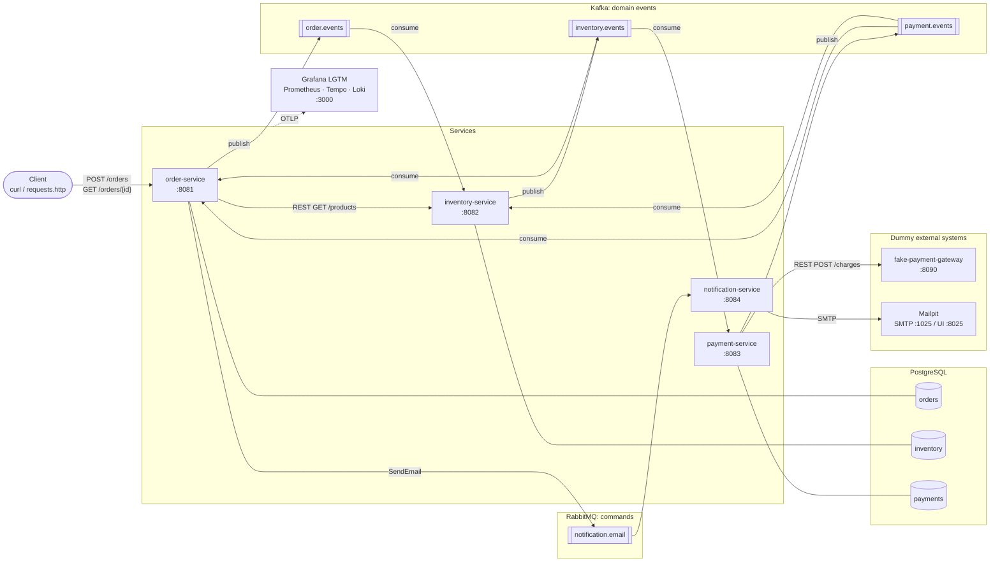
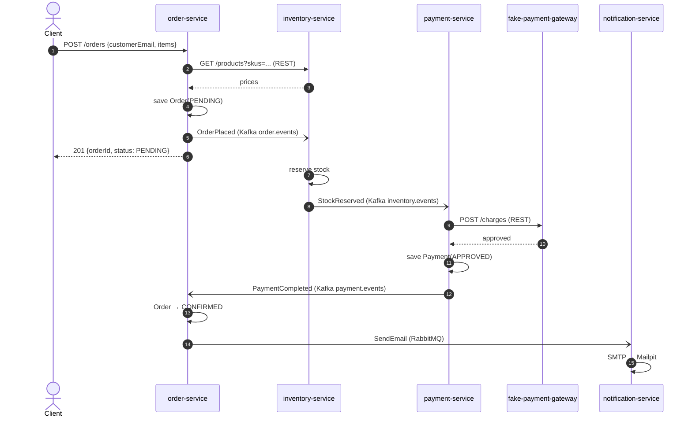
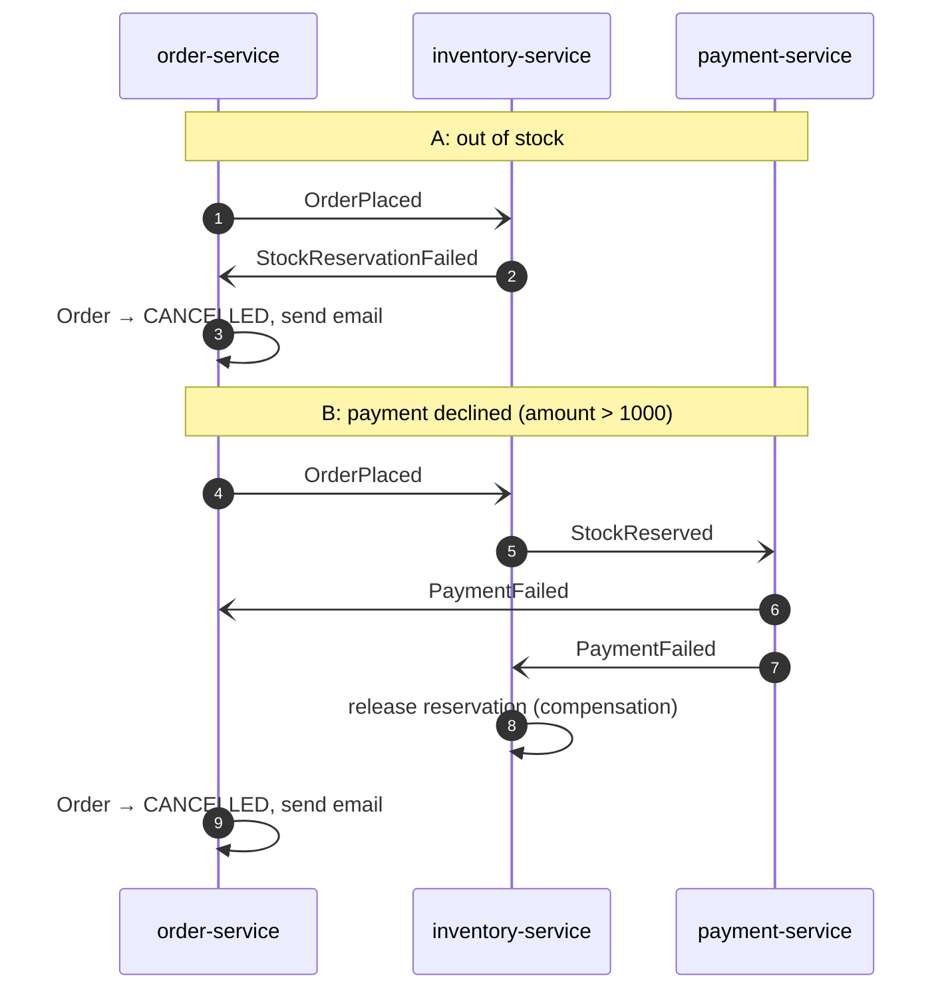

# Phase 1: Initial design

Phase 1 is a **naive baseline**. It sets the service boundaries, the code structure and the
interaction styles that every later phase builds on. Business logic is minimal. Some flaws
are left in on purpose, because later phases fix them (see [Potential flaws](#5-potential-flaws)).

## 1. System design



### Interaction styles

| Style | Used for | Semantics | Phase 1 usage |
|-------|----------|-----------|---------------|
| **REST** | Synchronous queries | Request/response, caller waits | Order reads prices from Inventory. Payment calls the gateway. |
| **Kafka** | Domain events | Facts in the past tense, pub/sub, replayable, keyed by `orderId` | `order.events`, `inventory.events`, `payment.events` |
| **RabbitMQ** | Commands | Imperative, point-to-point work queue | `SendEmail` to notification-service |

Each topic belongs to the bounded context that produces it. Only that service publishes
to it.

## 2. Services

| Service | Owns | Aggregates | Database |
|---------|------|------------|----------|
| order-service | Order lifecycle | `Order` (`PENDING` → `CONFIRMED` / `CANCELLED`) | `orders` |
| inventory-service | Product catalog and stock | `Product`, `Reservation` | `inventory` |
| payment-service | Payments | `Payment` (`APPROVED` / `DECLINED`) | `payments` |
| notification-service | Sending emails | none (stateless) | none |
| fake-payment-gateway | Dummy external system | none | none |

Business rules are deliberately trivial:
- Flyway seeds the products.
- Stock reservation is all-or-nothing per order.
- The gateway **declines any charge above 1000**, so you can trigger the failure path just
  by placing a large order.

## 3. Main interactions

### 3.1 Happy path



### 3.2 Failure paths (choreographed compensation)



### 3.3 Event contracts

The `contracts` module holds all events and commands as plain Java records, with no Spring
dependency. It is the only code the services share.

| Message | Channel | Producer | Consumers |
|---------|---------|----------|-----------|
| `OrderPlaced{orderId, customerEmail, lines, total}` | Kafka `order.events` | order | inventory |
| `StockReserved{orderId, customerEmail, amount}` | Kafka `inventory.events` | inventory | payment |
| `StockReservationFailed{orderId, reason}` | Kafka `inventory.events` | inventory | order |
| `PaymentCompleted{orderId, paymentId}` | Kafka `payment.events` | payment | order |
| `PaymentFailed{orderId, reason}` | Kafka `payment.events` | payment | order, inventory |
| `SendEmail{to, subject, body}` | RabbitMQ `notification.email` | order | notification |

Every message carries these headers: `eventId`, `eventType`, `correlationId` (= `orderId`)
and `causationId`. Phase 1 does not use them yet. They are there so that deduplication and
tracing can be added later.

> `StockReserved` repeats `amount` and `customerEmail` from `OrderPlaced` so that Payment
> doesn't need to know about orders. Every step has to pass data along like this, which is
> one of the costs of choreography.

## 4. Code structure

```
blocks-sample/
├── pom.xml                     parent (spring-boot-starter-parent 4.0.10, Java 17)
├── contracts/                  events, commands, topic/queue names, header constants
├── services/
│   ├── order-service/
│   ├── inventory-service/
│   ├── payment-service/
│   └── notification-service/
├── external/
│   └── fake-payment-gateway/
├── docker/                     Dockerfile, postgres init, grafana provisioning
├── docker-compose.yml
└── http/requests.http          demo requests
```

Each service follows the same DDD layout (example: order-service):

```
io.adzubla.blocks.sample.order
├── domain/            pure Java: Order, OrderLine, OrderStatus, Money, OrderRepository (interface)
├── application/       use cases + outbound ports (ProductCatalog, OrderEventPublisher, NotificationSender)
├── infrastructure/    adapters: JPA persistence, Kafka/RabbitMQ messaging, REST clients, config
└── interfaces/rest/   controllers and request/response DTOs
```

Dependencies point inwards. `domain` depends on nothing. `infrastructure` implements the
ports that `application` declares. JPA entities live in `infrastructure/persistence` and are
mapped to and from the domain objects.

## 5. Potential flaws

Phase 1 is intentionally naive. These are the known problems and the capability that
will fix each one:

| # | Flaw | Example | Fixed by |
|---|------|---------|----------|
| 1 | **Dual write**: the order is committed to Postgres and then published to Kafka. A crash between the two loses the event, and the order stays `PENDING` forever. | order-service dies right after the commit | Outbox pattern |
| 2 | **Duplicate deliveries** are processed again. Kafka and RabbitMQ deliver at least once. | A redelivered `StockReserved` charges the customer twice. A redelivered `OrderPlaced` reserves stock twice. | Idempotency & deduplication |
| 3 | **Client retries create duplicates.** `POST /orders` with the same `X-Idempotency-Key` creates a second order. | The user double-clicks, or the client retries after a timeout | Idempotency & deduplication |
| 4 | **Saga logic is scattered.** The order workflow is spread across three services' listeners. No single place shows the flow, and adding a step means changing several services. | Adding a "shipping" step | Saga orchestration |
| 5 | **Incomplete compensation.** If Payment crashes after charging but before publishing, stock stays reserved and the order stays `PENDING`. Nothing handles timeouts. | A gateway call succeeds but the service dies before it publishes | Saga orchestration + outbox |
| 6 | **Inconsistent REST errors.** Spring's default ProblemDetail has no stable error codes, and validation and domain errors look different from each other. | Unknown SKU, or an invalid request body | Unified error handler |
| 7 | **Synchronous coupling.** If inventory-service is down, `POST /orders` fails. | inventory-service is stopped | (later discussion: caching, or a local read model) |
| 8 | **No poison-message handling.** A message that always fails is retried forever, or dropped, depending on defaults. | An event that can't be deserialized | (later: DLQ / retry topics) |

The code marks each of these spots with `TODO(outbox)`, `TODO(idempotency)`, `TODO(saga)`
or `TODO(error-handler)`.

## 6. Runtime environment

| Container | Purpose | Port(s) |
|-----------|---------|---------|
| postgres:17 | One instance, one database per service | 5432 |
| apache/kafka (KRaft) | Event broker (containers use `kafka:9092`, the host uses `localhost:9094`) | 9094 |
| kafbat/kafka-ui | Inspect topics and messages | 8080 |
| rabbitmq:4-management | Command broker + UI | 5672 / 15672 |
| axllent/mailpit | Dummy email provider | 1025 / 8025 |
| grafana/otel-lgtm | Grafana, Prometheus, Tempo, Loki, OTLP collector | 3000 / 4317 / 4318 |
| order / inventory / payment / notification | Services | 8081–8084 |
| fake-payment-gateway | Dummy external system | 8090 |

All services export traces and metrics over OTLP. One order produces a single distributed
trace across REST, Kafka and RabbitMQ (5 services) that you can view in Grafana → Explore →
Tempo. Logs aren't exported over OTLP yet: read them with `docker compose logs`. Every log
line carries the `traceId`.

**Topic ownership.** Each service creates the topic it owns when it starts (a `NewTopic` bean,
3 partitions). Broker auto-creation is turned off. If it were on, a consumer that starts before
the owner would create the topic with 1 partition. The owner would then add partitions, which
consumers only notice minutes later and which breaks per-order ordering. This happened while
building Phase 1: an event sat in a partition that nobody was reading.

## 7. Running the demo

```bash
docker compose up --build -d      # first build takes a few minutes
```

Then run the requests in [`http/requests.http`](http/requests.http), or use curl:

```bash
curl -s -X POST localhost:8081/orders -H 'Content-Type: application/json' \
  -d '{"customerEmail":"ana@example.com","items":[{"sku":"KEYBOARD","quantity":1}]}'
curl -s localhost:8081/orders/<id>         # PENDING → CONFIRMED after a moment
```

| Scenario | Request | Outcome |
|----------|---------|---------|
| Happy path | KEYBOARD ×1 + MOUSE ×2 (89.70) | `CONFIRMED`, stock decremented, "confirmed" email |
| Out of stock | MONITOR ×5 (only 3 in stock) | `CANCELLED`, stock unchanged, "cancelled" email |
| Payment declined | LAPTOP ×1 (1499.00 > 1000) | `CANCELLED`, stock reserved then released, "cancelled" email |
| Unknown product | SKU `NOPE` | `400`, rejected synchronously, nothing published |
| Duplicate request | Same `X-Idempotency-Key` twice | Two orders (flaw #3) |

Watch it work:

| UI | URL |
|----|-----|
| Kafka UI (topics, messages and their headers) | http://localhost:8080 |
| RabbitMQ management (`app` / `app`) | http://localhost:15672 |
| Mailpit (sent emails) | http://localhost:8025 |
| Grafana (`admin` / `admin`) → Explore → Tempo | http://localhost:3000 |
| Products / Orders / Payments | http://localhost:8082/products · http://localhost:8081/orders · http://localhost:8083/payments |

Run just the infrastructure and start the services from an IDE (their defaults point at
`localhost`):

```bash
docker compose up -d postgres kafka rabbitmq mailpit lgtm kafka-ui
```

Build and run the unit tests without Docker: `mvn verify`.
